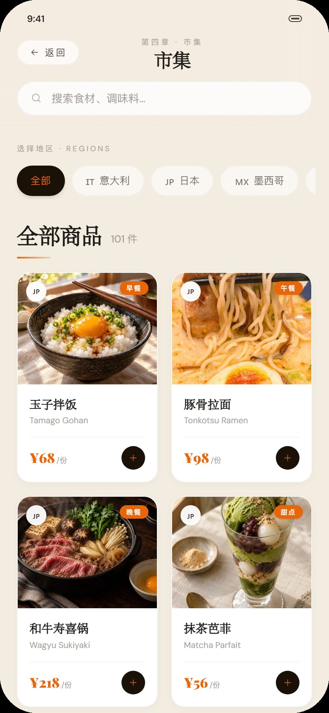
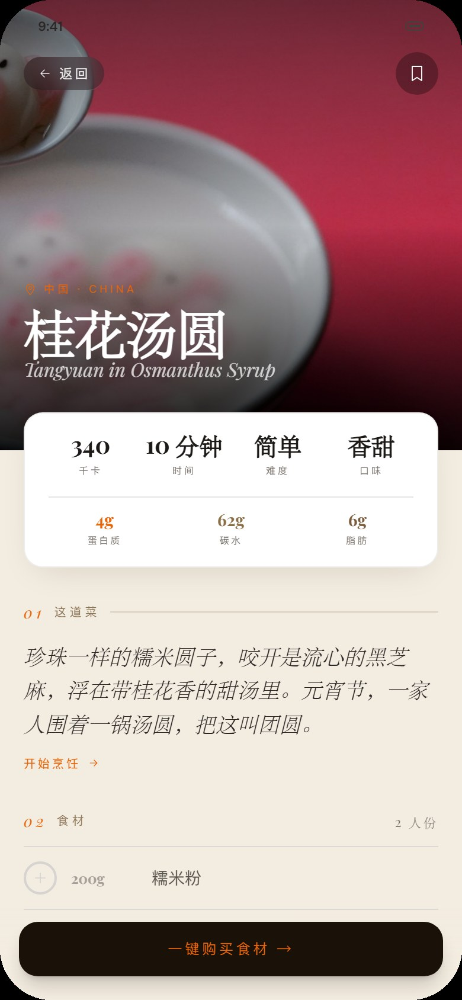
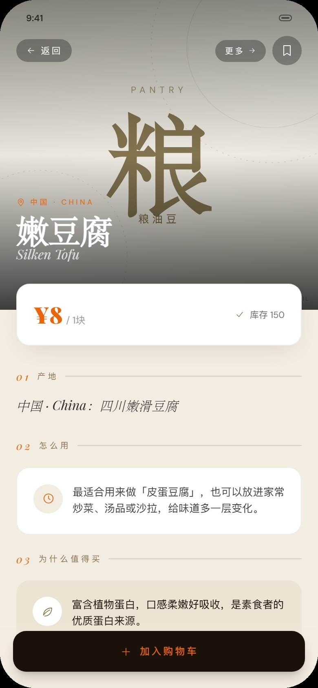
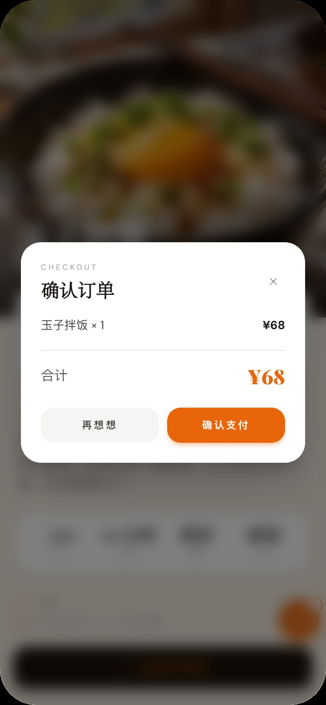

<div align="center">
  

  # 味途 · TasteTrail

  **一本可以吃的旅行地图。** 以目的地为线索的美食探索 Web 应用：每日主厨、时令菜谱、食材市集与旅行护照。

  Vue 3 · Vite 8 · Tailwind CSS 4 · JavaScript · 零后端依赖

  [在线体验](https://keleau.github.io/TasteTrail/) · [Gitee 展示仓库](https://gitee.com/keleau/taste-trail) · [GitHub 仓库](https://github.com/keleau/TasteTrail)
</div>

---

## 项目简介

味途是一款 **390 × 844 手机画布**的沉浸式美食产品，由本人独立完成产品设计与前端开发。它把「今天吃什么」这个日常问题，设计成一条完整的美食旅行链路：

**今日目的地 → 主厨来信 → 时令菜谱 → 食材加购 → 市集详情 → 购物车 → 演示结算 → 旅行护照**

项目内置 **6 个国家、36 道菜、101 件商品**，所有数据与素材本地化，无需后端服务，打开浏览器即可完整体验。

## 项目亮点

| 维度 | 完成情况 |
|---|---|
| **9 个完整页面** | 开屏、探索、今日、厨房、菜谱、我的、搜索、市集、商品详情 |
| **17 个可复用组件** | 单文件组件分层设计，配合 1 个自定义 Hook 与 4 个独立工具模块 |
| **完整业务闭环** | 菜谱配料自动匹配商城商品，一键加购、数量调整、结算成功态 |
| **时间感知体验** | 按中国时区切换早 / 午 / 黄昏 / 夜晚，触发对应入场动画与程序化环境音 |
| **移动端交互** | 可拖拽悬浮购物车、底部抽屉、粘性导航、滚动显现、视差主视觉 |

## 技术要点

- **Vue 3 组件化架构**：全程使用 Composition API 与 `<script setup>`，组件间通过 props / emits 通信，页面、组件、工具函数分层清晰，无 UI 组件库、无 CSS-in-JS。
- **智能配料匹配**：以纯函数把菜谱配料映射到商城可购商品，并对无法单独购买的配料设计“直接买整道菜”的兜底路径。
- **状态持久化**：购物车基于 `localStorage` 封装，刷新不丢失；悬浮按钮拖拽逻辑抽为可复用 Hook。
- **程序化音频**：用 Web Audio API 实时合成鸟鸣、咖啡馆、风铃、夜虫等环境音，不依赖任何音频文件。
- **动效体系**：时段入场动画、Ken Burns 主视觉、滚动显现、视差与折叠卡片，均由原生 CSS 与组合式逻辑实现。
- **工程化**：Vite 构建，本地 WOFF2 字体与 SVG 资源，零后端依赖，可直接部署到任意静态托管。

## 页面截图

<p align="center">
  
  
  
  
</p>
<p align="center"><sub>探索 · 今日 · 厨房 · 市集</sub></p>

<p align="center">
  
  
  
  
</p>
<p align="center"><sub>菜谱 · 食材档案 · 购物车 · 结算</sub></p>

## 核心功能

- **每日主厨**：按星期匹配目的地与主厨，今日主菜、主厨来信、招牌菜随日期变化。
- **六国菜单**：日本、意大利、墨西哥、法国、泰国、中国，每个国家 6 道菜，含卡路里、宏量营养、难度、口味与完整做法。
- **食材市集**：101 件商品，按国家筛选、关键词搜索、商品详情、相似推荐、库存与标签。
- **购物车**：`localStorage` 持久化、数量增减、删除、浮动按钮可拖拽，桌面与手机端均不遮挡内容。
- **搜索**：支持中英文检索 36 道菜与国家名，搜索历史可删除、可一键清空。
- **旅行护照**：探索国家、品尝菜品、完成菜谱，收集签证印章、成就与最爱菜系。

## 技术栈

| 层 | 选型 |
|---|---|
| UI | Vue 3（Composition API + `<script setup>`） |
| 构建 | Vite 8 |
| 样式 | Tailwind CSS 4 + 原生 CSS 动效 |
| 语言 | JavaScript（无 TypeScript） |
| 状态 | Vue 响应式 API + `localStorage` |
| 声音 | Web Audio API（无音频文件） |
| 素材 | 本地 JPG / WOFF2 / SVG |

## 工程结构

```text
src/
├─ main.js
├─ App.vue                  # 页面栈、购物车、结算、品牌外壳
├─ screens/                 # 9 个页面 SFC
│  ├─ SplashScreen.vue
│  ├─ ExploreScreen.vue
│  ├─ TodayScreen.vue
│  ├─ CookScreen.vue
│  ├─ RecipeScreen.vue
│  ├─ MeScreen.vue
│  ├─ SearchScreen.vue
│  ├─ ShopScreen.vue
│  └─ ShopItemDetailScreen.vue
├─ components/              # 17 个可复用组件
│  ├─ BrandMark.vue         # 品牌图形标
│  ├─ AppIcon.vue
│  ├─ BottomNav.vue
│  ├─ CartDrawer.vue
│  ├─ CheckoutModal.vue
│  ├─ FloatingCartButton.vue
│  ├─ ProductCard.vue
│  ├─ ProductArtwork.vue
│  ├─ PeriodIntro.vue
│  ├─ MealStats.vue
│  ├─ TimelineMeals.vue
│  └─ ...
├─ hooks/
│  └─ useDraggableButton.js # 悬浮按钮拖拽 Hook
├─ data/
│  ├─ images.js             # 图片映射
│  ├─ countries.js          # 六国 × 六餐 × 完整菜谱
│  ├─ heroes.js             # 每日主厨与目的地
│  └─ shop.js               # 菜品 / 食材 / 调味料
├─ lib/
│  ├─ matchShopItem.js      # 配料 → 商品匹配
│  ├─ productGroups.js      # 食材档案卡分组
│  ├─ periods.js            # 时段判定
│  └─ periodSound.js        # 程序化环境音
└─ style.css / fonts.css
```

## 快速开始

要求 Node.js **20.19+**（Vite 8 的最低要求）。

```bash
npm install
npm run dev
```

默认打开 `http://localhost:8444`。生产构建与本地预览：

```bash
npm run build
npm run preview
```

## 设计与素材说明

- **中文排版**：标题使用 Playfair Display + 宋体回退，正文使用 DM Sans + 苹方 / 微软雅黑，手写体使用 Caveat + 楷体；所有字体均为本地 WOFF2 或系统字体。
- **菜品图**：来自 Unsplash / Pexels 的免费图库素材，以及本人用 AI 生成并替换的 5 张菜品图与 3 张食材商品图。
- **食材与调味料**：优先使用商品图（大蒜、面筋、香油已补齐），其余暂无匹配图的商品采用统一的“档案卡”视觉（大字 + 分类色 + 编号线条）兜底。
- 图片来源与许可记录见 [`docs/image-manifest.json`](docs/image-manifest.json)。

> 结算流程为**演示**：点击“确认支付”仅清空购物车并展示成功态，不会产生真实扣款。

## 作者

**吴东盛** · 广州城建职业学院 · 2027 届 · 计算机应用技术

Gitee：[@keleau](https://gitee.com/keleau) · GitHub：[@keleau](https://github.com/keleau)
